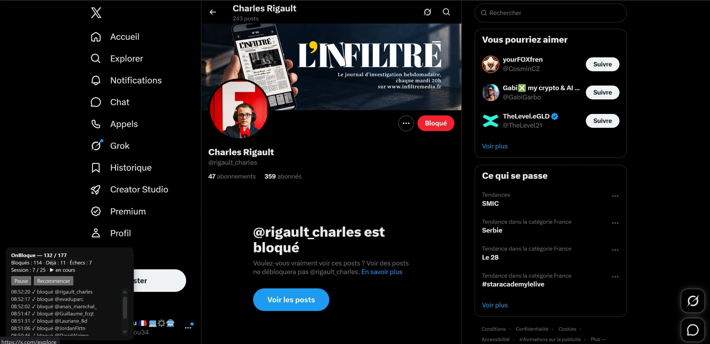

# OnBloque X

Extension Chrome/Edge qui bloque un par un, sur X, les comptes de la liste vérifiée de blockfacho (177 comptes, liste du 27/10/2026).

## Pourquoi bloquer ?

L'extension s'inscrit dans la campagne **#OnBloqueLExtremeDroite**, lancée en France fin octobre 2026 et inspirée d'une mobilisation née au Brésil. L'idée :

- **Ne plus nourrir la provocation.** Répondre, citer ou s'indigner sous un post, c'est de l'engagement : l'algorithme le montre alors à encore plus de monde. Bloquer, c'est cesser de leur apporter cette visibilité.
- **Reprendre la main sur son fil.** Un compte bloqué n'apparaît plus dans vos recommandations, vos réponses ni vos mentions. Vous choisissez ce que vous lisez, au lieu de laisser l'algorithme décider.
- **Peser collectivement.** Un blocage isolé ne change rien, des milliers de blocages réduisent l'audience que la plateforme accorde à ces comptes. C'est l'effet recherché par la campagne, sans que personne ne puisse le mesurer précisément de l'extérieur.
- **Se protéger.** Un compte bloqué ne peut plus vous suivre, vous mentionner ni répondre à vos posts.

Bloquer ne supprime aucun compte et ne signale personne : c'est un choix personnel sur ce qui s'affiche chez vous, réversible à tout moment depuis le profil (bouton **Bloqué** → Débloquer) ou dans les réglages de X.

La liste vient de [blockfacho](https://blockfacho.readymoss8.chatgpt.site/site) : élus et partis d'extrême droite, groupes, militants et médias, chaque entrée avec une source. Libre à chacun d'en retirer des comptes avant de lancer l'extension (voir Réglages).

## Installation

1. Ouvrir `chrome://extensions` (ou `edge://extensions`).
2. Activer le **Mode développeur**.
3. **Charger l'extension non empaquetée** → choisir ce dossier.

## Utilisation

Cliquer sur l'icône OnBloque. L'extension ouvre x.com si besoin et bloque les comptes un par un, avec une pause de 8 à 20 s entre chaque compte.

## Les sessions

L'extension travaille par **sessions de 25 comptes**. Une fois les 25 traités, elle se met en pause et le panneau affiche « Plafond de session atteint, reprenez plus tard ».

**Pourquoi** : X repère les comptes qui bloquent beaucoup de profils d'affilée et peut les limiter ou les suspendre. Des séries courtes avec des pauses ressemblent davantage à un usage normal.

**Pour continuer** : cliquer sur **Démarrer** dans le panneau, ou sur l'icône de l'extension. Une nouvelle session de 25 commence là où la précédente s'est arrêtée. Il faut environ 7 sessions pour toute la liste. Laisser passer quelques minutes, voire quelques heures, entre deux sessions réduit le risque.

**Le panneau** en bas à gauche de x.com indique :
- `132 / 177` : où on en est dans la liste ;
- `Bloqués` : comptes bloqués par l'extension ;
- `Déjà` : comptes que vous aviez déjà bloqués, sautés ;
- `Échecs` : comptes introuvables (supprimés, suspendus, renommés) ou page trop lente à charger ;
- `Session : 7 / 25` : comptes traités dans la session en cours.

La progression est gardée : on peut fermer l'onglet ou le navigateur et reprendre plus tard. **Recommencer** remet le compteur à zéro et repart du début de la liste ; les comptes déjà bloqués sont alors simplement sautés.

L'extension s'arrête aussi d'elle-même après **3 échecs d'affilée**, souvent le signe que X freine les blocages. Attendre un moment avant de relancer.

## Réglages

En haut de `content.js`, puis ↻ sur la carte de l'extension pour appliquer :

| Réglage | Par défaut | Rôle |
|---|---|---|
| `MAX_PAR_SESSION` | 25 | comptes par session avant la pause |
| `PAUSE_MIN_S` / `PAUSE_MAX_S` | 8 / 20 | pause aléatoire entre deux comptes, en secondes |

Monter `MAX_PAR_SESSION` va plus vite mais augmente le risque que X limite le compte.

Pour ne pas bloquer certains comptes, supprimer leur ligne dans la liste `LISTE` de `content.js`.

X interdit l'automatisation : utilisation à vos risques.
